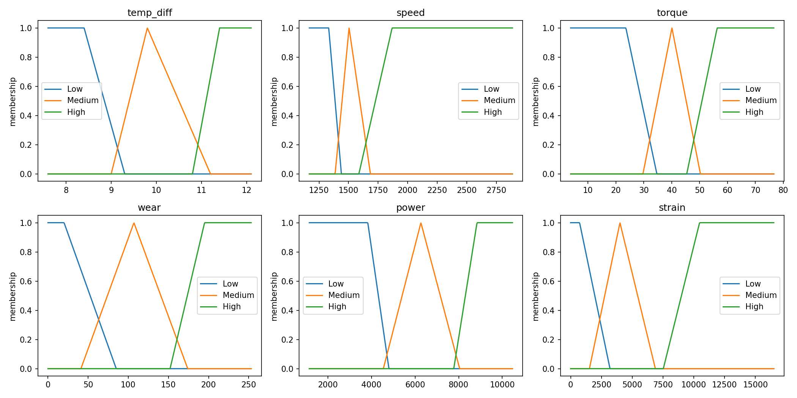

# Fuzzy Rule-Based Failure Detection on the AI4I 2020 Dataset

An interpretable fuzzy classifier that flags machine failures from sensor readings, built with plain Python (numpy, pandas, matplotlib, scikit-learn). The goal of this project is to show how fuzzy sets and fuzzy rules work end to end, and to compare them honestly against a Decision Tree baseline.

## Why fuzzy logic here

Failure conditions in industrial machines are usually described in words by engineers: "the temperature difference is low and the speed is low", "the power is too high". A crisp threshold (for example 8.6 K) treats 8.5 and 8.7 as completely different, which is not how the physics behaves. Fuzzy sets let a reading belong partly to "Low" and partly to "Medium", and rules written in plain language can be combined and inspected one by one.

## Dataset

AI4I 2020 Predictive Maintenance Dataset (UCI Machine Learning Repository), 10,000 rows with air temperature, process temperature, rotational speed, torque, tool wear and a binary machine failure label. Failures are rare (about 3.4 percent), so recall and F1 are reported instead of accuracy alone.

Download `ai4i2020.csv` from the UCI repository and place it in the project folder. The file is not committed to this repository.

Reference: S. Matzka, "Explainable Artificial Intelligence for Predictive Maintenance Applications", 2020.

## Method

1. **Feature engineering.** Three physical features are derived from the raw columns:
   - `temp_diff` = process temperature minus air temperature
   - `power` = torque x angular speed (watts)
   - `strain` = tool wear x torque
2. **Fuzzification.** Each variable (`temp_diff`, `speed`, `torque`, `wear`, `power`, `strain`) gets three linguistic levels: Low, Medium, High. Low and High are shoulder functions and Medium is a triangle. Breakpoints are percentiles of the training set only, so there is no leakage from the test set.
3. **Rules.** Five hand-written rules, using AND as the minimum of memberships:

| Rule | Condition | Idea |
|------|-----------|------|
| R1 Heat failure | temp_diff is Low AND speed is Low | Heat cannot dissipate at low speed |
| R2 Power too low | power is Low | Machine is underpowered |
| R3 Power too high | power is High | Machine is overloaded |
| R4 Overstrain | strain is High | Worn tool under heavy torque |
| R5 Worn + loaded | wear is High AND torque is High | Worn tool under load |

4. **Inference.** The risk score of a machine is the maximum firing strength over all rules (OR as maximum), a value between 0 and 1.
5. **Decision.** A machine is flagged as a failure when its risk is at or above a threshold chosen on the training set to maximize F1.
6. **Baseline.** A Decision Tree (max depth 5, balanced class weights) trained on the same features and split.

Split: 70 percent train, 30 percent test, stratified, `random_state=42`.

## Results (test set, 3000 samples, 102 failures)

| Model | Precision (failure) | Recall (failure) | F1 (failure) | False alarms | Missed failures |
|-------|--------------------|------------------|--------------|--------------|-----------------|
| Fuzzy classifier | 0.477 | 0.608 | 0.534 | 68 | 40 |
| Decision Tree | 0.415 | 0.951 | 0.577 | 137 | 5 |

The Decision Tree is better at catching failures. The fuzzy classifier raises about half as many false alarms and every decision can be traced to named rules. In a maintenance setting a missed failure is usually costlier than a false alarm, so the tree is the better pure predictor here, and the fuzzy system is the better explainer.

Note on fairness: the tree uses balanced class weights while the fuzzy threshold was tuned for F1, so the two are not at the same operating point.

### Recall by failure type

<!-- Fill this in from the per-type snippet in the script output -->

| Failure type | Count in test set | Fuzzy caught | Tree caught |
|--------------|-------------------|--------------|-------------|
| TWF (tool wear) | | | |
| HDF (heat dissipation) | | | |
| PWF (power) | | | |
| OSF (overstrain) | | | |
| RNF (random) | | | |

## Membership functions



## Example explanation

The script prints which rules fired for one machine. The example below is the highest scoring true failure in the test set, chosen to show the mechanism, so it is not a typical case.

```
temp_diff  speed  torque  wear   power    strain
9.9        1339   59.1    203    8286.99  11997.3

R1 Heat failure     0.00
R2 Power too low    0.00
R3 Power too high   0.48
R4 Overstrain       1.00
R5 Worn + loaded    1.00
Risk score = 1.00 -> FAILURE
```

## How to run

```
pip install -r requirements.txt
python fuzzy_ai4i.py
```

The script prints the confusion matrices and classification reports for both models, saves `membership_functions.png`, and prints a rule-firing explanation.

## Limitations

- The best threshold on the training set was 0.95, which suggests the risk score saturates: some rules reach 1.0 on normal machines because their High shoulders are wide. Tightening those shoulders is the first thing to try.
- Some failure types in this dataset (RNF, and partly TWF) are close to random, so no rule based on the sensors can catch them.
- Rules and membership breakpoints were designed by hand and not tuned extensively, to keep the system interpretable.
- Only the failure and no-failure decision is made. Identifying the failure type is not attempted.

## Possible extensions

- Add a second layer that classifies the failure type for flagged machines, as in hierarchical fuzzy plus Random Forest designs.
- Replace the maximum aggregation with a weighted TSK style output.
- Learn membership parameters with ANFIS and compare the loss in interpretability against the gain in accuracy.

## Files

- `fuzzy_ai4i.py`: full pipeline
- `membership_functions.png`: plot of all membership functions
- `requirements.txt`: Python dependencies